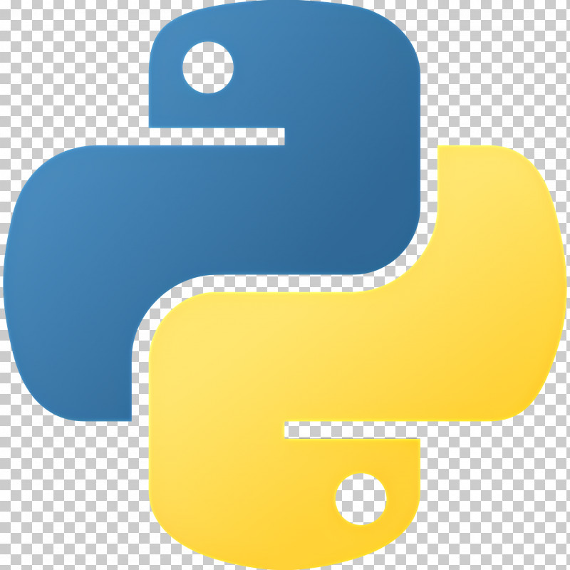

# Hello everyone, and welcome. 🫶

My name is Chris, and I am currently studying Web Development hoping to one day have a career in this field. I currently have an interest in everything to do with coding, and always looking for something to learn.
Python is my current favourite language to use as I having the most fun with it.

## Skills

Web Development | Frontend & Backend Development

## Tools 

<!--
**Djzngo/djzngo** is a ✨ _special_ ✨ repository because its `README.md` (this file) appears on your GitHub profile.

Here are some ideas to get you started:

- 🔭 I’m currently working on ...
- 🌱 I’m currently learning ...
- 👯 I’m looking to collaborate on ...
- 🤔 I’m looking for help with ...
- 💬 Ask me about ...
- 📫 How to reach me: ...
- 😄 Pronouns: ...
- ⚡ Fun fact: ...
-->
