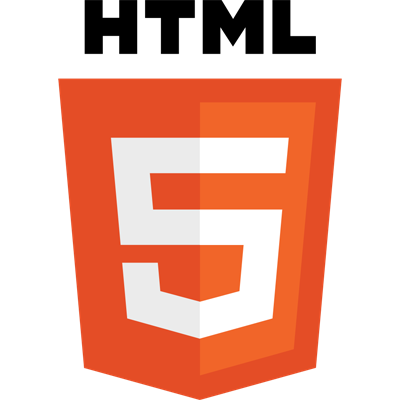
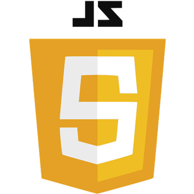
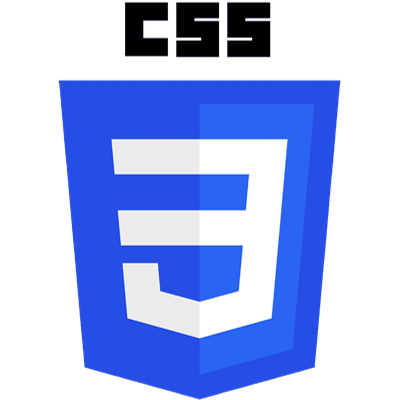
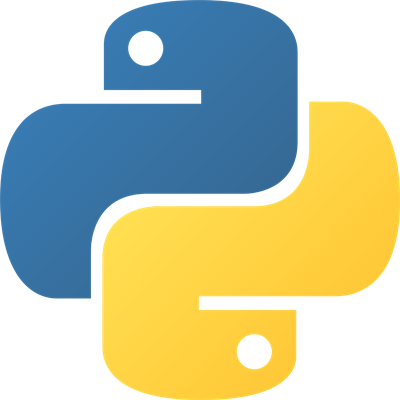
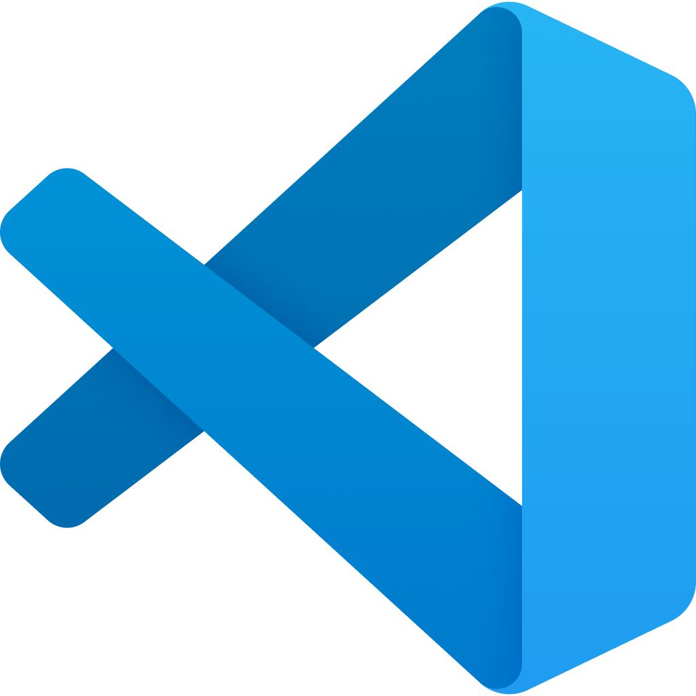
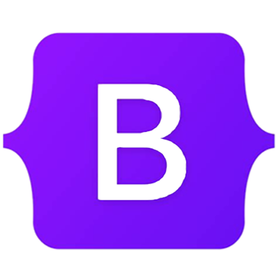

# Hello everyone, and welcome. 🫶

My name is Chris, and I am currently studying Web Development hoping to one day have a career in this field. I currently have an interest in everything to do with coding, and always looking for something to learn.
Python is my current favourite language to use as I having the most fun with it.

## Skills

Web Development | Frontend & Backend Development | Agile Developer

## Languages & Tools 
These are some of the currently languages, tools, and frameworks I know, and using everyday.

    
 
   
 

## Goals & Projects

- 📝 I'm currently working on Django project
- 🤔 I'm currently learning GDScript
- 📬 How to reach me: nmzbof (Discord)
